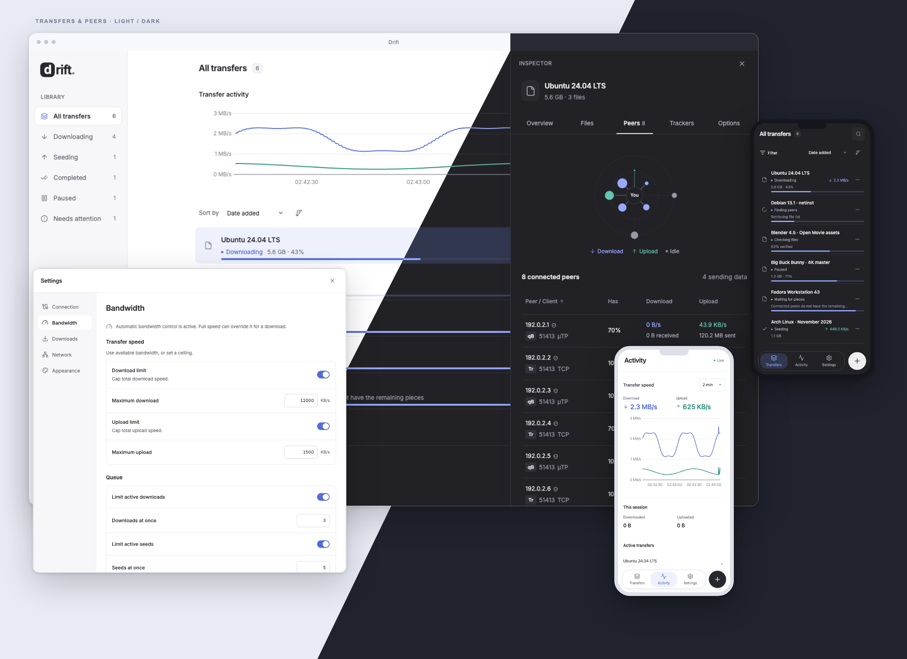

<h1 align="center">
  <picture>
    <source media="(prefers-color-scheme: dark)" srcset="docs/images/logo-dark.png">
    
  </picture>
</h1>

<p align="center"><strong>Actually good torrent UI.</strong></p>
<p align="center">A Transmission web client for desktop and mobile.</p>

<p align="center">
  
</p>

## Features

- **Transfers.** Search, filter, label, reorder, and manage torrents in batches.
- **Files and peers.** Select files, set priorities, and rename them. Inspect connections in a sortable peer list or an interactive graph.
- **Activity.** Follow download and upload charts, current speeds, and session totals.
- **Desktop and mobile.** Keyboard shortcuts and context menus on desktop. Touch controls and bottom navigation on phones.
- **Themes.** Light, dark, or system theme across the app and player. Settings save as you change them.
- **Video playback.** Watch complete or downloading files and resume where you left off. Requires the optional streaming companion and a browser that supports the file's codecs.
- **Automatic bandwidth control.** Optional router scripts slow downloads when other network activity needs the connection. Full speed bypasses those limits for a download.
- **Tracker VPN fallback.** The optional router integration retries failed IPv4 UDP trackers through a VPN and remembers successful routes. Peer traffic keeps its normal route.
- **Static files.** The web client needs no application server, database, or separate account.

## Install

Download **`drift-web.tar.gz`** from the [latest release](../../releases/latest).
It contains the ready-to-install web client; Bun and build tools are not needed
on your Transmission host. Release assets include `SHA256SUMS` for verification.

Extract the archive into the directory you want Transmission to serve:

```sh
mkdir -p /path/to/drift
tar -xzf drift-web.tar.gz -C /path/to/drift
```

If you extracted it on another computer, copy the extracted contents to your
Transmission host. Set
`TRANSMISSION_WEB_HOME` to that directory in the daemon's environment, then restart
Transmission. Open `/transmission/web/` at your Transmission address.

<details>
<summary>On OpenWrt</summary>

Copy the extracted release files to the router, then point the service at them:

```sh
uci set transmission.@transmission[0].web_home='/path/to/drift'
uci commit transmission
/etc/init.d/transmission restart
```

`/path/to/drift` should contain `index.html` and `assets/` directly.

</details>

Drift uses Transmission's RPC access settings. If you host the web client
separately, configure a proxy or CORS so it can reach the daemon. Tested with
Transmission 4.1. Requires Safari 15.4 / iOS 15.4.1 or a current Chrome or Firefox.

### Optional integrations

**The standard client works without these integrations.** Install them separately
on the Transmission host:

- **[Streaming companion](integrations/README.md#video-playback).** A Rust service that streams video, prioritizes missing data for playback and seeking, and finds matching SRT/WebVTT subtitles. It does not transcode files.
- **[Bandwidth controller](integrations/README.md#bandwidth-control).** OpenWrt scripts for automatic limits, Full speed, and recorded activity history.
- **[Tracker VPN fallback](integrations/README.md#tracker-vpn-fallback).** OpenWrt integration for an existing VPN. Supports IPv4 UDP trackers.

The [integration guide](integrations/README.md) covers requirements and setup.
The router scripts assume a configured OpenWrt system. Drift shows integration controls only when it detects the
corresponding service.

## Development

Svelte 5, TypeScript, Tailwind CSS, and Vite. Use Bun for packages and scripts.

```sh
bun install --frozen-lockfile
bun run dev
```

For a local proxy to a real daemon:

```sh
DRIFT_RPC_PROXY=http://router.local:9091 bun run dev
```

In Connection settings, set the RPC endpoint to `http://localhost:5173/transmission/rpc`.

Credentials stay in memory. For a separate web host, allow RPC requests through a
proxy or CORS and expose `X-Transmission-Session-Id`. Use HTTPS for remote RPC
connections that carry credentials; the optional streaming companion currently
requires a direct HTTP connection.

Before submitting changes:

```sh
bun run validate
```

For UI changes, install the browser engines once, then run the browser checks:

```sh
bun node_modules/@playwright/test/cli.js install chromium webkit
bun node_modules/playwright-legacy/cli.js install webkit
bun run test:e2e
bun run test:legacy
```

`validate` checks types, formatting, lint, unit tests, and the production build.
Browser tests use mock RPC data; the legacy check runs the built app in WebKit
15.4. Keep newer API and CSS fallbacks, keyboard access, visible focus, reduced
motion, and 44 × 44 CSS pixel touch targets. Test on physical devices too.
[AGENTS.md](AGENTS.md) contains the repository rules.

Deploy only the frontend's `dist/`. After building, you can upload it with
`bun scripts/deploy.ts user@host /path/to/drift`. The optional
`bun scripts/smoke.ts http://router.local:9091/transmission/web/` check uses a live
daemon and creates and removes a synthetic torrent; run it only on a suitable
host. Native integration builds and checks are in the [integration guide](integrations/README.md).

### Releases

Keep user-facing changes under `[Unreleased]` in [CHANGELOG.md](CHANGELOG.md).
Prepare a version with `bun run release:prepare 0.2.0` (or `0.2.0-rc.1` for a
prerelease). This moves those notes into a dated version section and synchronizes
the web package, companion manifest, and Cargo lockfile. Then run
`bun run format` and `bun run validate`, review and commit the changes, and push
the matching tag:

```sh
git tag -a v0.2.0 -m 'Release v0.2.0'
git push origin main v0.2.0
```

The [release workflow](.github/workflows/release.yml) validates the tag against
the web/native versions and current changelog section, runs the browser checks
(including pinned WebKit 15.4), and builds the release archives. It publishes only
after every job succeeds. Release descriptions contain that version's changelog
entry, excluding Unreleased and older entries. Prereleases do not replace the
latest stable release. No extra publishing secret is needed beyond GitHub's
provided `GITHUB_TOKEN` with release-write permission.

Assets: `drift-web.tar.gz`, `drift-stream-aarch64-unknown-linux-musl.tar.gz`,
`drift-stream-x86_64-unknown-linux-musl.tar.gz`,
`drift-openwrt-helpers.tar.gz`, and `SHA256SUMS`. ARM64 is the router-tested
companion target; x86-64 is cross-built and checked in CI. Other architectures
still require a source build. A failed publish can be rerun while its release is
a draft; published releases are never overwritten.

To inspect the current release description locally:

```sh
bun run release:notes v0.1.0 /tmp/drift-release-notes.md
```

## License

[MIT](LICENSE). Third-party notices are included in [public/licenses](public/licenses).
