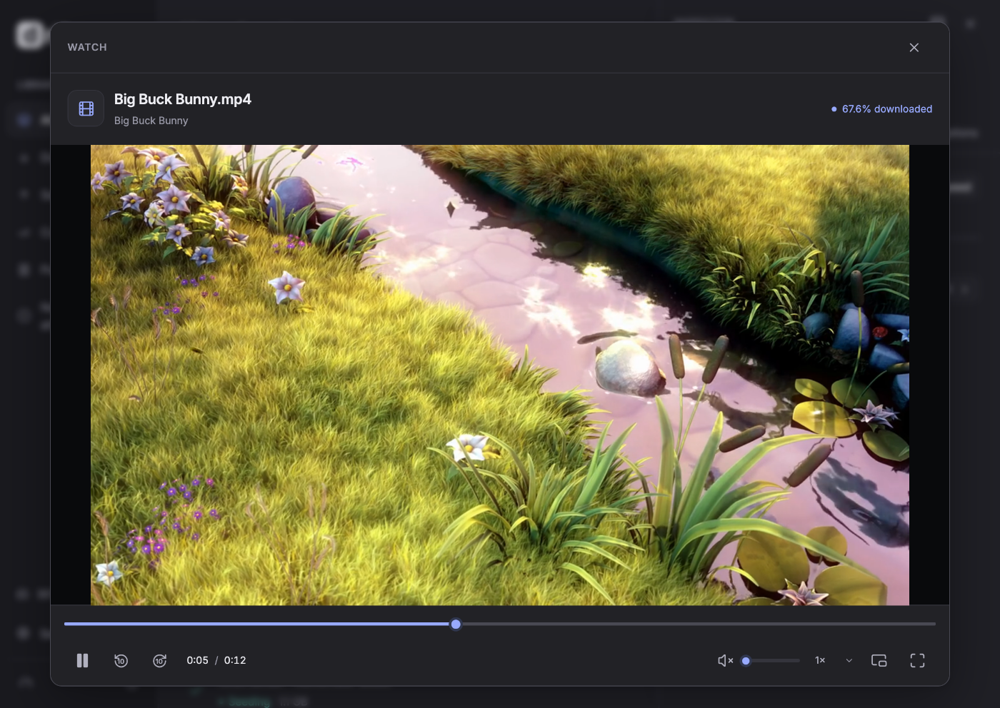

# Optional integrations

[Drift](../README.md) works without any of these. Add them to the Transmission
host for [video playback](#video-playback), [automatic bandwidth control](#bandwidth-control),
or [tracker VPN retries](#tracker-vpn-fallback). The web client detects installed services.

## Video playback

Watch while a file downloads, seek ahead, and resume later. Matching SRT and WebVTT
subtitles are supported. The Rust companion serves verified pieces; decoding
happens in the browser, with no transcoding.



<sub>Film: [Big Buck Bunny](https://www.bigbuckbunny.org/), © 2008 Blender Foundation. [CC BY 3.0](https://peach.blender.org/about/); frame scaled for the screenshot.</sub>

**Needs:** Transmission 4.1+, Linux 5.10+ with pidfd support, an explicit daemon
configuration directory, and read access to download folders. Streaming currently
requires direct HTTP. Both the RPC port and the next port must be reachable by the
browser: 9091 → 9092, for example. RPC port 65535 is unsupported.

Build on your computer with Bun and stable Rust with `rust-lld`:

```sh
bun integrations/openwrt/drift-stream/tasks.ts check
bun integrations/openwrt/drift-stream/tasks.ts build
```

The default target is `aarch64-unknown-linux-musl`; pass another Linux/musl target
after `build` if needed. Copy `integrations/openwrt/drift-stream/dist/` contents to
a staging directory on the router, run `sh install.sh` there as root, then restart
Transmission. The installer backs up and patches a recognized OpenWrt init script.
It does not restart services or open firewall ports. The companion follows
Transmission’s user, access settings, download roots, and process lifetime.

Worth knowing:

- Playback marks the video and matching subtitles wanted, enables sequential
  downloading, and resumes paused incomplete downloads. Closing the player leaves
  these settings in place. Players of the same torrent share one download cursor.
- Codec support depends on the browser. Missing pieces still need available peers;
  the displayed download percentage is not buffered playback time.
- Subtitle filenames must share the video’s directory and stem, such as
  `Episode 01.en.srt`. UTF-8 and BOM-marked UTF-16 work; ASS styling and encoding
  detection are unsupported.
- Restart after changing access settings or download roots. Remove
  `/usr/libexec/drift-stream.procd` and restart to disable streaming. Check the init
  hook after OpenWrt package upgrades.

<details>
<summary>Checks and troubleshooting</summary>

If playback is unavailable, check the companion process, adjacent port, and HTTP
connection. For rejected credentials, sign in again. For stalled playback, check
verification status and piece availability before assuming a codec problem.

`tasks.ts check` runs installer tests, Rust formatting, Clippy, and Rust tests.
For hardware measurements, build the companion and frontend, install local FFmpeg
and Playwright Chromium, then run:

```sh
bun integrations/openwrt/drift-stream/benchmark.ts root@router.local 19091 --player > stream-benchmark.json
```

This needs SSH key access and five free ports starting at 19091. It creates an
isolated Transmission instance, temporary services, and fixtures on the download
disk, then cleans them up. Production Transmission stays running, but the test
uses CPU, disk, and network capacity.

</details>

## Bandwidth control

Downloads yield when the network gets busy and recover after twenty quiet seconds.
**Full speed** bypasses automatic limits for a selected download while the others
keep yielding. The controller also records an hour of activity history.


**Needs:** OpenWrt with fw4/nftables, `transmission-remote`, `curl`, `ucode` with
`fs` and `socket` modules, `snice`, and external storage mounted at `/home`.
These scripts assume locally permitted unauthenticated RPC; authenticated setups
need credential handling added to the helpers. There is no turnkey installer.

1. Copy `transmission-yield`, `transmission-priority.uc`, and
   `transmission-trackers.uc` from [openwrt/](openwrt/) to `/usr/libexec/`. Make
   `transmission-yield` executable. All three files are required, even without VPN retries.
2. Add a named `transmission_yield_traffic` byte counter to `inet fw4`, with rules
   counting other traffic and excluding local Transmission and management polling.
   Install `openwrt/transmission-yield-interactive.nft` under `/etc/nftables.d/` as
   a fw4 table include for the second counter.
3. Run `/usr/libexec/transmission-yield` under your service supervisor after storage
   and firewall setup. The helper reads Transmission’s UCI RPC and `web_home`
   settings. Its `DRIFT_RPC_URL` override and the shell’s `rpc` option must point
   to the same daemon.

<details>
<summary>Defaults and diagnosis</summary>

Set overrides in `/etc/config/transmission_yield`:

```text
config transmission_yield 'main'
    option rpc '127.0.0.1:9091'
    option interval '2'
    option idle_seconds '20'
    option traffic_bytes_per_second '8192'
    option interactive_packets_per_second '20'
    option busy_download_kbytes '128'
    option busy_upload_kbytes '32'
    option minimum_available_kbytes '16384'
    option maximum_cpu_percent '70'
```

Limits and memory use KiB; times use seconds. Traffic must cross either threshold
for three consecutive samples. CPU or memory pressure, missing counters, and
counter resets apply limits immediately. UDP packet rate is a heuristic for calls
and games; it excludes common discovery ports.

Full speed settings are saved in `/home/.transmission-priority/state.json` and
restored when the override ends, the download pauses, completes, or fails. Closing
the browser does not stop the controller.

Check `/var/run/transmission-yield.status` and
`/var/run/transmission-priority.status` for current state. Missing controls usually
mean a helper failed, `/home` is unmounted, or the configured web home is not
writable. It must receive fresh `full-speed.json` and `activity.json` files.

</details>

## Tracker VPN fallback

Retry failed IPv4 UDP trackers through an existing VPN. Successful routes are
remembered; failed attempts are dropped. Peer connections keep their normal routes.


**Needs:** the bandwidth helper above, a default-route WireGuard or AmneziaWG WAN,
VPN masquerading, and `ip`, `nft`, `ubus`, and `conntrack`. No extra daemon is needed.
Check these reserved identifiers against your router before enabling the helper:

| Resource        | Reserved value             |
| --------------- | -------------------------- |
| nft table       | `inet drift_trackers`      |
| Route table     | `31200`                    |
| Rule priorities | `1391`, `1392`             |
| Packet bits     | `0x01000000`, `0x02000000` |

Tunnel selection follows `/var/run/awg-policy.json` when present, otherwise the
active compatible default-route interface with the lowest metric. No healthy
tunnel means retries are unavailable. HTTP(S) trackers, IPv6, DHT, and PEX are
outside this integration’s scope.

Retries expire after 90 seconds. Successful routes are stored in
`/home/.transmission-priority/tracker-vpn.json`; a later failure removes them.
Trackers sharing an endpoint share its discovery route. Selected tracker packets
cannot fall back to another route if the VPN disappears.

For diagnosis, check `trackerVpn` in `full-speed.json`,
`nft list table inet drift_trackers`, routing rules, and conntrack entries. The VPN
badge records a successful announcement; counters show traffic actually using the route.
