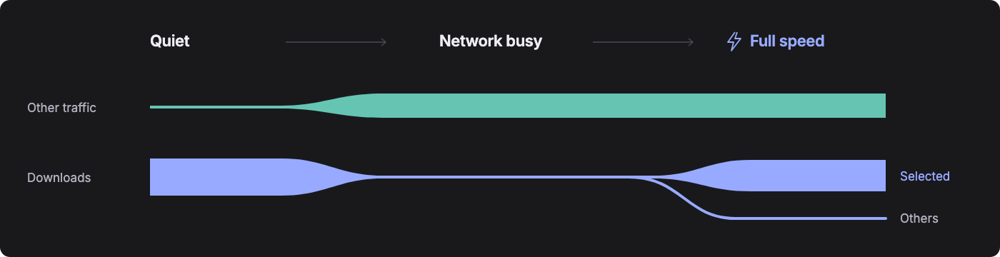
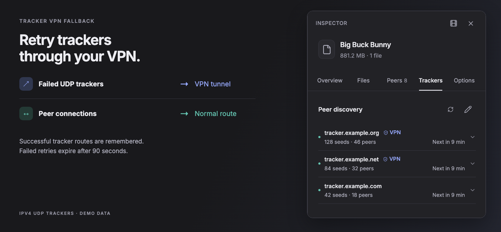

# Optional integrations

[Drift](../README.md) works without any of these. Add them to the Transmission
host for [video playback](#video-playback), [automatic bandwidth control](#bandwidth-control),
or [tracker VPN retries](#tracker-vpn-fallback). The web client detects installed services.

## Video playback

Watch while a file downloads, seek ahead, and resume later. Matching SRT and WebVTT
subtitles are supported. The Rust companion serves verified pieces; decoding
happens in the browser, with no transcoding.


<sub>Film: [Big Buck Bunny](https://www.bigbuckbunny.org/), © 2008 Blender Foundation. [CC BY 3.0](https://peach.blender.org/about/); frame scaled for the screenshot.</sub>

**Needs:** Transmission 4.1+, Linux 5.10+ with pidfd support, an explicit daemon
configuration directory, and read access to download folders. Streaming currently
requires direct HTTP. Both the RPC port and the next port must be reachable by the
browser: 9091 → 9092, for example. RPC port 65535 is unsupported.

### Install

On your computer, from the repository root (Bun and stable Rust with `rust-lld`):

```sh
bun integrations/openwrt/drift-stream/tasks.ts build
ssh root@router.local 'mkdir -p /tmp/drift-stream'
scp -r integrations/openwrt/drift-stream/dist/* root@router.local:/tmp/drift-stream/
ssh root@router.local 'sh /tmp/drift-stream/install.sh && /etc/init.d/transmission restart'
```

Replace `router.local` with your router’s address. The default build is ARM64;
pass `x86_64-unknown-linux-musl` after `build` for x86-64. The installer backs up
and patches the OpenWrt Transmission init script. It does not open firewall ports.

Worth knowing:

- Playback marks the video and matching subtitles wanted, enables sequential
  downloading, and resumes paused incomplete downloads. Closing the player leaves
  these settings in place. Players of the same torrent share one download cursor.
- Codec support depends on the browser. Missing pieces still need available peers;
  the displayed download percentage is not buffered playback time.
- Subtitle filenames must share the video’s directory and stem, such as
  `Episode 01.en.srt`. UTF-8 and BOM-marked UTF-16 work; ASS styling and encoding
  detection are unsupported.
- Restart after changing access settings or download roots. Remove
  `/usr/libexec/drift-stream.procd` and restart to disable streaming. Check the init
  hook after OpenWrt package upgrades.

## Bandwidth control

Downloads yield when the network gets busy and recover after twenty quiet seconds.
**Full speed** bypasses automatic limits for a selected download while the others
keep yielding. The controller also records an hour of activity history.



**Needs:** OpenWrt with fw4/nftables, `transmission-remote`, `curl`, `ucode` with
`fs` and `socket` modules, `snice`, and external storage mounted at `/home`.
These scripts use locally permitted unauthenticated RPC and Transmission’s UCI
`rpc_bind_address`, `rpc_port`, and `web_home`. Set those before starting; custom
RPC authentication needs changes to the helpers.

### Install

On your computer, from the repository root:

```sh
scp integrations/openwrt/transmission-yield integrations/openwrt/transmission-priority.uc integrations/openwrt/transmission-trackers.uc root@router.local:/usr/libexec/
scp integrations/openwrt/transmission-yield-interactive.nft root@router.local:/etc/nftables.d/
ssh root@router.local
```

All three scripts are required: `transmission-priority.uc` imports
`transmission-trackers.uc`, even when VPN retries are unused.

On the router, install the helper packages ([OpenWrt 25.12+ uses apk](https://openwrt.org/docs/guide-user/additional-software/apk); older versions use `opkg install`):

```sh
apk add transmission-remote curl ucode-mod-fs ucode-mod-socket procps-ng-snice
```

Make the controller executable and add the other-traffic counter.
This example counts routed traffic through the router; Transmission itself must
run on the router so its traffic stays out of this counter.

```sh
chmod 755 /usr/libexec/transmission-yield
cat > /etc/nftables.d/transmission-yield-traffic.nft <<'EOF_NFT'
counter transmission_yield_traffic {}
chain transmission_yield_traffic_forward {
    type filter hook forward priority 10; policy accept;
    counter name transmission_yield_traffic
}
EOF_NFT
fw4 check && /etc/init.d/firewall reload
```

If you already have this named counter, keep its rules instead. The supplied
[`transmission-yield-interactive.nft`](openwrt/transmission-yield-interactive.nft)
counts forwarded UDP separately, excluding common discovery ports.

Start it with procd so it survives closing SSH and starts at boot:

```sh
cat > /etc/init.d/transmission-yield <<'EOF_SERVICE'
#!/bin/sh /etc/rc.common
START=95
USE_PROCD=1
start_service() {
    procd_open_instance
    procd_set_param command /usr/libexec/transmission-yield
    procd_set_param respawn
    procd_set_param stdout 1
    procd_set_param stderr 1
    procd_close_instance
}
EOF_SERVICE
chmod 755 /etc/init.d/transmission-yield
/etc/init.d/transmission-yield enable
/etc/init.d/transmission-yield start
cat /var/run/transmission-yield.status
```

Mount `/home` before starting. The default RPC address is `127.0.0.1:9091`; change
`rpc` in the configuration below if your daemon uses another port.

<details>
<summary>Defaults and diagnosis</summary>

Set overrides in `/etc/config/transmission_yield`:

```text
config transmission_yield 'main'
    option rpc '127.0.0.1:9091'
    option interval '2'
    option idle_seconds '20'
    option traffic_bytes_per_second '8192'
    option interactive_packets_per_second '20'
    option busy_download_kbytes '128'
    option busy_upload_kbytes '32'
    option minimum_available_kbytes '16384'
    option maximum_cpu_percent '70'
```

Limits and memory use KiB; times use seconds. Traffic must cross either threshold
for three consecutive samples. CPU or memory pressure, missing counters, and
counter resets apply limits immediately. UDP packet rate is a heuristic for calls
and games; it excludes common discovery ports.

Full speed settings are saved in `/home/.transmission-priority/state.json` and
restored when the override ends, the download pauses, completes, or fails. Closing
the browser does not stop the controller.

Check `/var/run/transmission-yield.status` and
`/var/run/transmission-priority.status` for current state. Missing controls usually
mean a helper failed, `/home` is unmounted, or the configured web home is not
writable. It must receive fresh `full-speed.json` and `activity.json` files.

</details>

## Tracker VPN fallback

Retry failed IPv4 UDP trackers through an existing VPN. Successful routes are
remembered; failed attempts are dropped. Peer connections keep their normal routes.



### Install

The `transmission-trackers.uc` module is installed and run by the controller above;
there is no second service to start. It also needs a default-route WireGuard or AmneziaWG WAN,
VPN masquerading, and `ip`, `nft`, `ubus`, and `conntrack`.
Install the additional routing tools on the router:

```sh
apk add ip-full conntrack
```

Check these reserved identifiers against your router before enabling the helper:

| Resource        | Reserved value             |
| --------------- | -------------------------- |
| nft table       | `inet drift_trackers`      |
| Route table     | `31200`                    |
| Rule priorities | `1391`, `1392`             |
| Packet bits     | `0x01000000`, `0x02000000` |

Tunnel selection follows `/var/run/awg-policy.json` when present, otherwise the
active compatible default-route interface with the lowest metric. No healthy
tunnel means retries are unavailable. HTTP(S) trackers, IPv6, DHT, and PEX are
outside this integration’s scope.

Retries expire after 90 seconds. Successful routes are stored in
`/home/.transmission-priority/tracker-vpn.json`; a later failure removes them.
Trackers sharing an endpoint share its discovery route. Selected tracker packets
cannot fall back to another route if the VPN disappears.

For diagnosis, check `trackerVpn` in `full-speed.json`,
`nft list table inet drift_trackers`, routing rules, and conntrack entries. The VPN
badge records a successful announcement; counters show traffic actually using the route.
